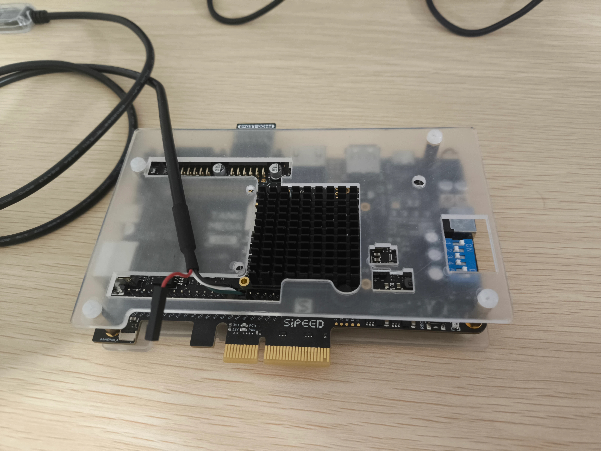
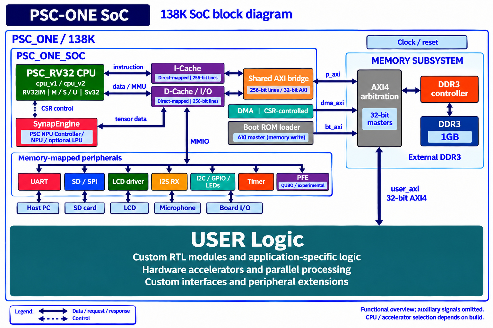

# PSC-ONE for the Tang Mega 138K

## SoC block diagram

The PSC_RV32 CPU uses separate instruction and data caches and controls peripherals through memory-mapped I/O. 
The AXI4 arbiter gives the CPU, DMA engine, and boot ROM loader shared access to external DDR3 memory. 
Custom hardware in `USER_LOGIC` can access the same memory through its own 32-bit AXI4 port.

## USER_LOGIC

`USER_LOGIC` is an FPGA region connected to the PSC-ONE AXI bus. You can use it to implement your own logic. I plan to use this region for an AI accelerator and confidential company logic.

## UART connection

The onboard BL616 UART appears to be unavailable in this configuration. For serial communication, connect a USB-to-UART adapter with 3.3 V logic levels to the GPIO pins above the PCIe connector. The [board constraint file](cst/PSC_ONE_tang138k_cst.cst) defines the FPGA pin assignments.

| Board signal | FPGA pin | USB-to-UART adapter pin |
| --- | --- | --- |
| `gpio_uart_tx` (output) | A13 | RX |
| `gpio_uart_rx` (input) | B15 | TX |
| GND | — | GND |

## License

You may use this design under the terms of the [PSC-ONE MIT License](../../LICENSE).
