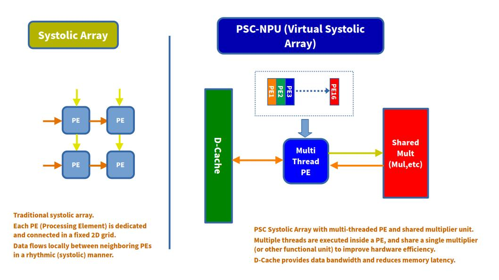

# PSC-NPU legacy (SynapEngine)

[PSC-ONE](../../../../README.md) · [Documentation](../../../../docs/README.md)

This document describes the implementation in `npu/src` as of **2026-10-29**.
`legacy` is its build-selection name, not an indication that it is unused:
`Makefile.cpu` and `Makefile.pscos` currently default to `NPU_VERSION=legacy`.
It supports raw INT8/UINT8 GEMM with INT32 output and retained accumulation
with per-channel INT8 requantization. PSC-OS also provides a software batch
API over the same 4×4 hardware commands.

See [NPU v1](../npu_v1/README.md) for the separate fixed four-lane MAC and
[NPU v2](../npu_v2/README.md) for the encoded-weight shift/add experiment.
Those implementations do not advertise the retained-INT8 capability.
NPU version names are independent of `CPU_VERSION`.
`Makefile.npu` and `Makefile.nextpnr.npu` default to v1, so explicitly pass
`NPU_VERSION=legacy` when testing or synthesizing this directory.
Historical measurements below are labeled with their scope; they are not
resource or timing guarantees for the current complete SoC.

PSC-ONE AI is a hardware accelerator for matrix multiplication (GEMM), based on an **Output-Stationary systolic array architecture**.

Its compute engine, **SynapEngine**, is a core component of the **PSC-ONE full-stack SoC**, integrating a custom RISC-V CPU, memory subsystem, operating system, and AI accelerator into a single experimental platform.

SynapEngine explores a virtualized Processing Element architecture in which PE contexts, control logic, and arithmetic units are separated. This allows multiple logical PEs to share a smaller number of physical arithmetic units.

---

<!-- contents -->
- [Architecture](#architecture)
- [Overview](#overview)
- [Current Architecture](#current-architecture)
- [Key Features](#key-features)
- [Output-Stationary Dataflow](#output-stationary-dataflow)
- [Virtualized Processing Elements](#virtualized-processing-elements)
- [External Arithmetic Units](#external-arithmetic-units)
- [Configurable Multiplier Count](#configurable-multiplier-count)
- [Operator-Independent PE Architecture](#operator-independent-pe-architecture)
- [Execution of Larger Matrices](#execution-of-larger-matrices)
- [Potential Topology Reconfiguration](#potential-topology-reconfiguration)
- [Potential FIR Filter Application](#potential-fir-filter-application)
- [Memory System Integration](#memory-system-integration)
- [Programming Model](#programming-model)
- [CSR Interface](#csr-interface)
- [Retained Accumulation and INT8 Output](#retained-accumulation-and-int8-output)
- [Command Lifecycle and Memory Handshake](#command-lifecycle-and-memory-handshake)
- [PSC-OS and TFLite Integration](#psc-os-and-tflite-integration)
- [Systolic Array vs PicoRV32 — Yosys Analysis](#systolic-array-vs-picorv32--yosys-analysis)
- [Verification](#verification)
- [Execution Example](#execution-example)
- [Directory Structure](#directory-structure)
- [Current Status](#current-status)
- [Future Work](#future-work)
- [Design Philosophy](#design-philosophy)
- [PSC-LPU v0.1](#psc-lpu-v01)
- [License](#license)
- [Author](#author)
<!-- /contents -->

## Architecture

This diagram shows the integration of SynapEngine within the PSC-ONE system.



> Diagram note: “share a single multiplier” describes the shared-arithmetic
> concept. The legacy multiplier count is configurable; NPU v1 uses four
> physical multiplier lanes. The drawing is not an exact v1/v2 netlist.

SynapEngine is connected directly to the PSC-ONE CPU and memory subsystem. Matrix addresses and accelerator control parameters are configured by the CPU, while matrix data is transferred through the shared memory and cache architecture.

---

## Overview

PSC-NPU (SynapEngine) is currently implemented as a **4×4 int8 Output-Stationary systolic array**.

Unlike a conventional systolic array in which every PE contains a dedicated multiplier, SynapEngine separates the following components:

* PE state and accumulation registers
* Systolic dataflow control
* Arithmetic execution units
* Memory access control

The PE array therefore represents a set of **logical execution contexts**, while multiplication is performed by a configurable number of shared external multipliers.

This architecture is conceptually similar to hardware multithreading:

* Multiple logical PE contexts are maintained
* PE control logic is shared
* Arithmetic units are scheduled across PE contexts
* The number of physical multipliers can be selected independently of the logical array size

The main objective is to reduce duplicated control and arithmetic resources while preserving the behavior of a 4×4 systolic array.

---

## Current Architecture

### Logical Array Size

The current PSC-NPU (SynapEngine) configuration provides:

* Logical array size: **4×4**
* Number of logical PE contexts: **16**
* Input data type: **signed INT8 or unsigned UINT8** for raw GEMM;
  **signed INT8** for retained accumulation
* Partial-sum width: **32 bits**, wrapping on overflow
* Dataflow: **Output-Stationary**
* Shared external multipliers
* Configurable physical multiplier count

The Controller and Engine default to `MUL_NUM=4`; the current CPU v1 instance
uses that default. `PE_N=4` is the supported array configuration, not a
runtime topology selector. `MATRIX_N` does not override the runtime dimensions.

```text
CPU v1 CSRs / coherent cache_io request path
  └─ PSC_NPU_Controller (NPU/LPU build-time selection)
      └─ PSC_NPU_Engine (command snapshot, tile loops, completion)
          ├─ PSC_NPU_ReadController (A/B tile reads)
          ├─ PSC_NPU_SystolicArray4x4
          │   ├─ PSC_NPU_PE_INT (16 contexts / accumulators, shared FSM)
          │   └─ PSC_NPU_PE_Mult (MUL_NUM shared pipelined lanes)
          └─ PSC_NPU_TilePost (parameter load, ACC seed, INT8 packing)
              └─ PSC_NPU_Requantize (serial per-element INT32 requantization)
```

The requantizer has a separate signed 32×32 multiplication datapath; it does
not increase the number of INT8 MAC lanes. The alternative LPU branch is
described [below](#psc-lpu-v01).

The logical 4×4 PE array does not require one dedicated multiplier for every PE.

Instead, multiplication requests generated by the PE contexts are collected and processed by the external arithmetic unit.

---

## Key Features

* 4×4 logical int8 systolic array
* Output-Stationary dataflow
* Virtualized PE architecture
* Hardware-multithreading-style PE execution
* Shared PE control logic
* External arithmetic execution units
* Configurable number of physical multipliers
* Separation of dataflow and arithmetic operations
* Potential support for operators other than multiplication
* Cycle-based execution model
* CPU-controlled accelerator interface
* Direct integration with the PSC-ONE cache and memory system
* Shared coherent cache path with software ordering and buffer ownership
* Synthesizable RTL; whole-SoC FPGA fit/timing requires separate validation
* cocotb-based verification
* Support for larger matrices through 4×4 tiled execution
* FIRST/CONTINUE/LAST commands retaining one output tile across K segments
* Per-channel initialization, multiplier and shift; INT8 output zero-point/clamp

---

## Output-Stationary Dataflow

PSC-NPU (SynapEngine) currently uses **Output-Stationary (OS)** dataflow.

In Output-Stationary mode:

* Matrix A data flows horizontally
* Matrix B data flows vertically
* Each logical PE retains its partial sum
* Multiplication results are accumulated into the corresponding PE context
* Completed output values are written back after accumulation finishes

For matrix multiplication:

```text
C = A × B
```

each output element is calculated as:

```text
C[i][j] = Σ A[i][k] × B[k][j]
```

The partial sum for `C[i][j]` remains associated with its logical PE until the complete dot product has been calculated.

This reduces intermediate memory write-back traffic because partial sums do not need to be repeatedly stored in external memory.

---

## Virtualized Processing Elements

A conventional systolic array normally places a complete multiply-accumulate datapath inside every PE.

SynapEngine instead separates PE state from arithmetic execution.

Each logical PE maintains state such as:

* A input register
* B input register
* Partial-sum register
* Dataflow state
* Valid and completion state
* Thread or context state

The multiplication itself is performed outside the PE array by the shared arithmetic unit.

Conceptually:

```text
Logical PE contexts
        │
        │ multiplication requests
        ▼
External arithmetic scheduler
        │
        ▼
Configurable multiplier units
        │
        │ multiplication results
        ▼
Logical PE accumulation state
```

This organization resembles hardware multithreading because several PE contexts share the same execution resources.

The current multiplier snapshots a batch and services fixed groups of contexts
through registered operand/product stages. Results are held until the PE's
shared FSM accumulates them after all required products have arrived. This is
a fixed batch schedule, not an out-of-order scheduler or concurrent execution
of independent output tiles.

---

## External Arithmetic Units

The multiplication units are implemented outside the logical PE array.

This provides several architectural advantages:

* The multiplier count is independent of the logical PE count
* FPGA DSP usage can be selected according to device capacity
* PE control logic does not need to be duplicated with each multiplier
* Arithmetic units can be pipelined or replaced independently
* Resource usage and execution latency can be traded against each other

For example, a 4×4 logical array contains 16 PE contexts, but it does not require 16 physical multipliers.

A configuration may use:

```text
Logical PE contexts : 16
Physical multipliers: 1, 2, 4, 8, or 16
```

A smaller multiplier count reduces DSP and logic usage, while a larger multiplier count increases arithmetic throughput.

The current Controller configuration uses four shared INT8 multiplier lanes
to execute requests from the 16 logical PE contexts.

---

## Configurable Multiplier Count

The number of physical multipliers is controlled by an RTL parameter.

At the Controller/Engine level, the default is:

```verilog
parameter integer MUL_NUM = 4;
```

This is an elaboration-time parameter, not a CSR. The standalone
`PSC_NPU_PE_Mult` module defaults to two, but the Controller passes its own
value through the array. The multiplier clamps its effective lane count to
1..16 for the 16-context array and schedules fixed groups across those lanes.

For a logical array containing `N` arithmetic lanes, the approximate number of execution groups is:

```text
ceil(N / MUL_NUM)
```

For example, with 16 logical multiplication requests:

| Physical multipliers | Execution groups |
| -------------------: | ---------------: |
|                    1 |               16 |
|                    2 |                8 |
|                    4 |                4 |
|                    8 |                2 |
|                   16 |                1 |

The actual total execution time also includes systolic data movement, pipeline latency, control cycles, and memory access latency.

This configurability allows SynapEngine to be adapted to different FPGA devices without changing the logical programming model.

---

## Operator-Independent PE Architecture

Because arithmetic execution is separated from PE state and dataflow control, the external execution unit is not fundamentally limited to integer multiplication.

The current implementation performs:

```text
A × B
```

However, the same PE request-and-response architecture could potentially support:

* int8 multiplication
* int16 multiplication
* FP16 multiplication
* BF16 multiplication
* Multiply-add operations
* Addition or subtraction
* Maximum or minimum operations
* Logical operations
* Custom activation functions
* Application-specific arithmetic units

For example:

```text
PE request:
    operand_A
    operand_B
    operation
    destination_context

Execution unit:
    result = operation(operand_A, operand_B)

PE response:
    destination_context
    result
```

This makes PSC-NPU (SynapEngine) closer to a configurable dataflow engine than a fixed array of hard-wired MAC units.

Support for operations other than integer multiplication is a future extension and is not yet part of the current implementation.

---

## Execution of Larger Matrices

The physical and logical PSC-NPU (SynapEngine) array size is currently 4×4, but larger matrices can be calculated by dividing them into 4×4 tiles.

For an `N×N` matrix, where `N` is a multiple of four:

```text
Tile count per dimension = N / 4
```

For example:

| Matrix size | Tiles per dimension | Output tile count |
| ----------: | ------------------: | ----------------: |
|         4×4 |                   1 |                 1 |
|         8×8 |                   2 |                 4 |
|       12×12 |                   3 |                 9 |
|       16×16 |                   4 |                16 |

Each output tile may require multiple 4×4 matrix multiplications along the K dimension.

Therefore, a 12×12 matrix multiplication is executed as a sequence of operations on the 4×4 SynapEngine array rather than by using a physical 12×12 PE array.

---

## Potential Topology Reconfiguration

The current PSC-NPU (SynapEngine) dataflow is organized as a 4×4 two-dimensional systolic array.

However, because logical PE contexts are separated from physical arithmetic units, a future implementation may allow the logical PE connections to be reconfigured.

For example, the same 16 logical PE contexts could potentially be arranged as:

```text
4 × 4
2 × 8
8 × 2
1 × 16
16 × 1
```

The current organization:

```text
PE  PE  PE  PE
PE  PE  PE  PE
PE  PE  PE  PE
PE  PE  PE  PE
```

could therefore be logically transformed into a one-dimensional pipeline:

```text
PE → PE → PE → PE → PE → PE → PE → PE
   → PE → PE → PE → PE → PE → PE → PE → PE
```

This would require configurable inter-PE routing and additional dataflow control. It is a future architectural concept and is not implemented in the current version.

---

## Potential FIR Filter Application

A one-dimensional arrangement such as **1×16** could potentially be used for finite impulse response filtering.

An FIR filter calculates:

```text
y[n] = Σ h[k] × x[n-k]
```

This operation consists of repeated multiplication and accumulation, similar to a matrix dot product.

A 1×16 SynapEngine configuration could associate:

* One PE context with each FIR tap
* Input samples with streamed A operands
* Filter coefficients with B operands
* External multipliers with shared tap execution
* Partial-sum propagation with the FIR accumulation chain

Conceptually:

```text
x[n] ──► PE0 ──► PE1 ──► PE2 ──► ... ──► PE15 ──► y[n]
          ×h0      ×h1      ×h2              ×h15
```

The same logical PE contexts and arithmetic units could therefore be reused for both:

* 2D matrix multiplication
* 1D convolution
* FIR filtering
* Dot-product processing

This is one motivation for separating logical PE topology from the physical arithmetic units.

---

## Memory System Integration

SynapEngine is tightly integrated with the PSC-ONE memory architecture.

The current design provides:

* CPU-configured physical addresses (user virtual addresses require kernel staging)
* CPU-configured matrix base addresses
* Direct connection to the PSC-ONE memory and cache subsystem
* The CPU v1 coherent `cache_dma_controller_io.sv` path
* Separate accelerator memory-access control
* 32-bit packed transfers for int8 input data
* Raw INT32 output or four packed INT8 outputs per write

The CPU specifies the addresses of matrices A, B, and C before starting the accelerator.

The accelerator then reads matrix data through the shared PSC-ONE memory path
and writes completed results back to memory. The driver uses memory fences
and kernel-owned staging buffers. A fence orders accesses; it is not a cache
flush for an arbitrary noncoherent DMA port.

The Engine configures the A/B reader with `RADDR_MASK=0x00FFFFFF` (the
standalone reader default is different). The initial A/B cursor for each
4×4 tile is masked to 24 bits; row increments then advance that cursor.
Raw C writes and TilePost parameter/output accesses use full 32-bit addresses.
Use physical buffers in the supported memory map, with all accessed A/B bytes
inside the 24-bit range. Do not rely on high-address aliasing. Bases must be
word-aligned, regions must not overlap, and address arithmetic must not wrap.

---

## Programming Model

The accelerator is controlled by the PSC-ONE CPU through accelerator control and address registers.

A typical software workflow is:

1. Acquire accelerator ownership and prepare physical A/B/C buffers.
2. Acknowledge any previous completion with `state_reset` and release it.
3. Configure dimensions, addresses, signed mode and instruction.
4. Order input stores with the driver's memory fence, then assert `start`.
5. Wait for `done`; inspect `error` for retained-INT8 commands.
6. Order completion before reading/copying the output.
7. Deassert `start` and acknowledge completion before the next command.

For retained commands, check capability before issuing instructions 1..4,
and keep ownership across the entire FIRST/CONTINUE/LAST sequence.

The current execution mode is Output-Stationary.

Weight-Stationary mode is not currently implemented.

### Legacy controller matrix dimensions

The legacy `PSC_NPU_Controller` supports `A[M][K] * B[K][N] = C[M][N]`:

| Input | Meaning | Supported values |
| --- | --- | --- |
| `matrix_size_x` | K: A columns / B rows | 4..252, multiples of four |
| `matrix_size_y` | N: B/C columns | 4..252, multiples of four |
| `matrix_size_m` | M: A/C rows | 1..255; 0 uses `matrix_size_y` |

For `A[1][4] * B[4][4]`, set `(matrix_size_m, matrix_size_x, matrix_size_y)`
to `(1, 4, 4)`. For `A[2][4] * B[4][4]`, use `(2, 4, 4)`.
The output contains respectively four or eight 32-bit elements.

A and B contain contiguous row-major bytes; C contains contiguous row-major
32-bit results. No extra rows or memory padding are required for A or C.
The read controller leaves unused A tile rows at zero and issues no reads for
them. Writeback emits only the valid rows. Signed and unsigned modes use the
same dimensions and memory layout.

All dimensions, addresses, `signed_mode` and the instruction are captured
when `start` is accepted. Drive `matrix_size_m=0` explicitly to request M=N;
do not depend on an undriven input. CPU v1 now connects M to `SA_SIZE[23:16]`.
NPU v1/v2 also have an M input, but their arithmetic/control details are
separate from the retained-INT8 implementation documented here.

These are the raw GEMM **software preconditions**. Instruction 0 does not
validate dimensions or alignment and must not be used to probe invalid
inputs. For signed mode both A and B are INT8; for unsigned mode both are
UINT8. Accumulation wraps modulo 2^32, with no saturation, bias or activation
in raw mode. Retained commands have the stricter checked limits below.

## CSR Interface

The following mapping is implemented by the current CPU v1 connection.
These are custom CPU CSRs, not memory-mapped peripheral offsets.

| CSR | Address | Fields |
| --- | --- | --- |
| `SA_CTRL` | `0x7C0` | start[0], state_reset[1], clear[2], signed[3], OS[4], instruction[11:8] |
| `SA_SIZE` | `0x7C4` | K[7:0], N[15:8], M[23:16] |
| `SA_STATUS` | `0x7C8` | done[0], busy[1], error[2], acc_valid[3], retained-INT8 capability[8] |
| `SA_ADDR_A` | `0x7D0` | A physical byte address |
| `SA_ADDR_B` | `0x7D4` | B physical byte address |
| `SA_ADDR_C` | `0x7D8` | Raw C address or retained parameter/scratch block address |

`SA_CTRL[4]` is retained in the software control format, but is not connected
as a dataflow selector to this Engine: only Output-Stationary is implemented.
`status_extra` supplies bits 2, 3 and 8; CPU v1 combines it with busy/done.
Capability is zero while the NPU is held in reset (`PSC_NPU_OFF`), in LPU or
disabled configurations, and in the separate v1/v2 wrappers. Software must
read bit 8 before using retained commands; do not probe older hardware by
issuing an unsupported instruction.

## Retained Accumulation and INT8 Output

The Engine can keep **one output tile** in its sixteen existing accumulators
across multiple commands. No intermediate INT32 output is written to memory.

| instruction | Operation | Memory output |
| ---: | --- | --- |
| 0 (RAW) | Clear each output tile, run tiled GEMM | M×N INT32 values at C |
| 1 (FIRST) | Load parameters, seed all ACCs, accumulate first K segment | None |
| 2 (CONTINUE) | Accumulate another K segment into retained ACCs | None |
| 3 (LAST) | Accumulate final segment, requantize | M rows of four INT8 bytes |
| 4 (SINGLE) | FIRST and LAST in one command | M rows of four INT8 bytes |
| 5..15 | Reject, invalidate retained state | None; done+error |

Instructions 1..4 require `signed_mode=1`, **M=1..4**, **N=4**,
**K=4..252 in multiples of four**, and word-aligned A/B/C addresses.
M=0 fallback applies only to RAW. CONTINUE/LAST additionally require
`acc_valid=1` and the same M and C base as FIRST. A/B addresses and K may
change between segments. Invalid command fields or sequences complete with
error, invalidate the retained tile, and issue no memory requests.

Each segment supplies tightly packed row-major `A[M][K]` and `B[K][4]`.
For an actual K not divisible by four, software pads the segment with A=0
and B=0. For K=2304, software uses nine 252-element segments and one
36-element segment: FIRST, eight CONTINUEs, then LAST. Hardware does not
store the total K or gather strided slices from a larger A matrix.

### Parameter block and output layout

For instructions 1..4 only, C points to an **80-byte**, word-aligned block.
It is not the address of the final tensor. The first 64 bytes contain sixteen
little-endian INT32 parameter words; the last 16 bytes are output scratch.

| Byte offset | Contents |
| ---: | --- |
| 0..15 | Four per-channel initial ACC values |
| 16..31 | Four signed INT32 multipliers |
| 32..47 | Four signed INT32 shifts, −31..30 |
| 48 | Signed output zero-point, −128..127 |
| 52 | Signed activation minimum, −128..127 |
| 56 | Signed activation maximum, −128..127 and ≥ minimum |
| 60 | Reserved, must be zero |
| 64..79 | INT8 output, four allocated bytes per row, up to four rows |

FIRST/SINGLE reads the sixteen words and seeds each row with the same four
channel initial values. CONTINUE/LAST reuses the captured parameters without
reading them again. Invalid parameters are detected after parameter reads;
they produce done+error without MAC execution or output writes.

For TFLite symmetric weights (`weight_zero_point=0`), software supplies
`initial[c] = bias[c] - input_zero_point * sum(real_weights[c])`.
The RTL receives this corrected value, not a separate bias or input-zero
register. Correction is applied once per output, not once per K segment.
Spatial padding uses `input_zero_point`; K padding uses zero A/B bytes, and
the weight sum excludes padding.

Output row r is written at `C + 64 + 4*r` as `{c3,c2,c1,c0}`, with c0 in
bits [7:0]. Only M rows are written. All four channel bytes are allocated
even for a partial tensor channel group; software copies only valid channels
from scratch into the final tensor.

### Requantization arithmetic

For each accumulator and its channel parameters:

```text
left  = max(shift, 0)
right = max(-shift, 0)
lhs   = INT32_low_bits(acc << left)
high  = SaturatingRoundingDoublingHighMul(lhs, multiplier)
q     = RoundingDivideByPOT(high, right)
out   = clamp(INT32_low_bits(q + output_zero), activation_min, activation_max)
```

The implementation follows the repository-pinned gemmlowp rounding rules,
including negative ties and the `INT32_MIN * INT32_MIN → INT32_MAX` case.
ACC addition, left shift and output-zero addition keep the low 32 bits;
there is no general saturating accumulator. Software must establish safe
ranges when numerical overflow is unacceptable. TilePost processes outputs
serially through the registered shift/multiply/high-multiply/divide/round
stages, then packs four bytes per write. This differs from the LPU's simple
arithmetic shift and saturation.

## Command Lifecycle and Memory Handshake

* Start is accepted only in IDLE, with clear/state_reset inactive and no
  previously observed high start still held. Deassert start between commands;
  busy-time pulses are not queued and held-high start does not retrigger.
* Ordinary command inputs are snapshotted at acceptance. Changing them while
  busy does not alter the running command.
* `done` is sticky until state_reset or clear. FIRST/CONTINUE completion
  retains ACCs and parameters. A done-time state_reset acknowledges completion
  and clears error while preserving that retained state.
* Clear in IDLE/DONE invalidates ACCs and clears error. FIRST replaces a
  previous retained tile; RAW discards retained validity. LAST/SINGLE clears
  `acc_valid` after output completes. Treat acc_valid as usable for a next
  command only after the preceding command has completed successfully.
* A busy-time state_reset or clear latches an abort request. The Engine
  **finishes the current command and drains its memory responses**, then
  clears state and returns to IDLE. It can still write output during this
  interval; software must discard that output and wait for busy to clear
  before reusing any buffers.
* Each memory operation waits for `sa_req_ready`, emits a one-cycle valid
  pulse, and waits for `rd_read_ready` or `c_write_ready`. There is one
  outstanding transaction. These are request/response signals, not a
  conventional interface that holds valid until response-ready.
* The coherent cache controller captures requests into its SA pending slot.
  In CPU v1, both completion inputs connect to `sa_ready`. RAW and
  LAST/SINGLE assert done only after the final write response.
* There is no hardware bus timeout. If a response never arrives, busy can
  remain asserted. The driver drains on timeout; if draining fails, it keeps
  ownership and quarantines the buffers/device instead of reusing them or
  starting a CPU fallback. Global reset assumes the NPU and shared bus/cache
  are reset together.

These lifecycle rules describe the NPU Engine; the alternative LPU has its
own busy-time control behavior described below.

## PSC-OS and TFLite Integration

The public interfaces are in
[`synap_api.h`](../../../../software/os/src/api/synap_api.h) and
[`sa_qtile.h`](../../../../software/os/src/api/sa_qtile.h).
Raw `sa_run_rect_checked()` supports rectangular matrices subject to its
software buffer limit `SA_MAT_MAX=64`, which is separate from the RTL limits.
`sa_capabilities()` is a read-only query.

`SYS_SA_RUN=10` retains the existing raw interface and adds these flags:

| a5 flag | Operation |
| --- | --- |
| `0x10000000` | Read capabilities without issuing an NPU command |
| `0x20000000` | `sa_run_qtile_checked`: one output tile, all K segments |
| `0x20000001` | `sa_run_qbatch_checked`: bounded software batch |

QTILE accepts A[M][K], B[K][4], C[M][4], M=1..4 and K=4..2304 in multiples
of four. QBATCH accepts A[M][K], B[N/4][K][4], C[M][N], M=1..8, N=4 or 8,
and the same K range. These are software API limits, not single-command
hardware dimensions. The kernel validates user ranges and snapshots
parameters/inputs into physical staging buffers. Ownership is shared with
RAW and retained throughout the complete tile/batch. Output is copied to
the user only after the operation succeeds.

The OS build option selects the TFLite path:

| `TFLITE_NPU_QTILE` | Behavior |
| ---: | --- |
| 0 (default) | Existing raw NPU path with CPU accumulation/postprocessing |
| 1 | 4×4 retained-INT8 tiles |
| 2 | Up to 8×8 software batches using the same retained-INT8 commands |

Mode 2 reuses packed A/B panels and reduces syscall/kernel copy overhead.
It completes all K segments of one 4×4 tile before starting the next; it
does not enlarge the array, retain multiple output tiles simultaneously,
or reduce the hardware command count relative to mode 1. A maximal batch
contains four output tiles and forty commands. Kernel and user software
must be built with the matching interface. Both new modes remain opt-in.

Convolution input gathering/padding, weight packing, initial-value correction
and final tensor placement remain software work. Unsupported operators or
quantization ranges use the existing supported paths; there is no direct
Conv address generator or fused SiLU in this RTL.

See the [retained-INT8 implementation report](../../../../../report/psc-npu-int8-retained-20261028.md)
and [software batch report](../../../../../report/psc-npu-qtile-phase1-20261028.md)
for driver checks, memory budgets and measured results.

---

## Systolic Array vs PicoRV32 — Yosys Analysis

This is an **archived array-only, two-multiplier comparison**, not a synthesis
result for the current four-lane Controller with TilePost/Requantize. It must
not be used to estimate the present NPU's complete resource usage.

PicoRV32 is an archived generic-cell result; its MUX count is corrected to 100
from the saved log. FF-family counts are register cells, not individual bits.
See the [CPU comparison and provenance](../../../../docs/cpu.md#psc_rv32-vs-picorv32-yosys-analysis).

### Resource Comparison

| Metric         | SynapEngine (4×4) | PicoRV32 |
| -------------- | ----------------: | -------: |
| Cells          |               555 |      515 |
| Multipliers    |             **2** |    **0** |
| Adders         |                25 |        8 |
| Multiplexers   |               113 |      100 |
| FF-family cells |                88 |      105 |
| Control Logic  |          Moderate |     High |

> Multiplexer counts include Yosys `$mux` cells only and exclude `$pmux` cells.

The comparison illustrates two different architectural approaches:

* **SynapEngine:** dataflow-oriented compute engine
* **PicoRV32:** control-oriented general-purpose processor

Although SynapEngine exposes a logical 4×4 PE array, its arithmetic resources are shared. In this configuration, the 16 logical PE contexts use only two physical multiplier units.

---

## Verification

PSC-NPU (SynapEngine) is verified using cocotb-based simulation.

The test environment compares:

```text
Hardware result
```

against:

```text
Software reference result
```

Current verification includes:

* 4×4 int8 matrix multiplication
* Output-Stationary accumulation
* Logical PE context execution
* Shared external multiplier scheduling
* Packed memory input
* Matrix result write-back
* Larger matrix execution using 4×4 tiling
* Full PSC-ONE CPU and accelerator integration

The retained-INT8 tests additionally cover K segmentation, per-channel
parameters, rounding boundaries, partial rows, invalid sequences, held start,
command snapshots, delayed responses and busy-time reset/drain behavior.

Recorded results from 2026-10-28 (not rerun for this documentation update):

| Scope | Recorded result |
| --- | --- |
| Requantization vs pinned gemmlowp | 20,728 vectors PASS |
| Legacy PE/array/controller regression | 22 tests PASS |
| Retained tile RTL and Conv-generated tile replay | PASS, including K=2304 and 54 Conv tiles |
| CPU v1 + real cache/SDRAM `npu_test1` | PASS, final PIO `0x0000BEEF` |
| PSC-OS syscall + retained/batch + legacy RTL POINTCONV | PASS, matching tensor/output hashes |
| Full YOLO CPU/RAW/QTILE/batch comparison | 289 intermediate tensors and final bytes match in host arithmetic-model tests |

Full YOLO host-model results are not a full-model RTL or FPGA-board result.
Detailed provenance and the historical basic-suite LPU configuration failure
are retained in the [implementation report](../../../../../report/psc-npu-int8-retained-20261028.md).
The LPU-specific test passed when run with the LPU configuration.

From the repository root, representative commands are:

```bash
# Arithmetic reference and standalone RTL (Icarus, g++, project Python environment).
python3 PSC-ONE/hardware/rtl/soc/npu/tests/requantize.py
# run_tile.py also needs this generated Conv replay fixture.
# The generator appends, so create the fixture only if it is absent.
if [ ! -f build/npu-int8-20261028/conv-vectors-retry.bin ]; then
  PSC_QTILE_VECTORS="$PWD/build/npu-int8-20261028/conv-vectors-retry.bin" \
    myenv/bin/python PSC-ONE/software/os/tests/tflite/qtile_conv.py
fi
myenv/bin/python PSC-ONE/hardware/rtl/soc/npu/tests/run_tile.py

# Existing raw PE/array/controller tests; explicitly select this implementation.
PATH="$PWD/myenv/bin:$PATH" \
make -C PSC-ONE/hardware/sim -f Makefile.npu validate_streaming \
  NPU_VERSION=legacy SIM_BUILD="$PWD/build/npu-readme-regression"

# NPU-only synthesis/place-and-route; not whole-SoC timing.
make -C PSC-ONE/hardware/sim -f Makefile.nextpnr.npu timing \
  NPU_VERSION=legacy BUILD_DIR="$PWD/build/npu-readme-timing"
```

The current quantization/tile runners use fixed paths under
`build/npu-int8-20261028`; inspect existing artifacts before rerunning them.
For the CPU-driven retained-INT8 test and its exact single-test invocation,
see [`npu_test1` results and commands](../../../../../report/psc-npu-test1-20261028.md).

---

## Execution Example

The following example shows a **12×12 matrix multiplication** executed on PSC-ONE using SynapEngine.

The 12×12 operation is divided into 4×4 tiles and processed sequentially by the logical 4×4 Output-Stationary array.

```text
PSC_OS> sa_start
A
2 4 6 8 10 12 14 16 18 20 22 24
4 6 8 10 12 14 16 18 20 22 24 26
6 8 10 6 14 16 18 20 22 24 26 28
8 10 12 14 16 18 20 22 24 26 28 30
10 12 14 16 18 20 22 24 26 28 30 32
12 14 16 18 20 22 24 26 28 30 32 34
14 16 18 20 22 24 26 28 30 32 34 36
16 18 20 22 24 26 28 30 32 34 36 38
18 20 22 24 26 28 30 32 34 36 38 40
20 22 24 26 28 30 32 34 36 38 40 42
22 24 26 28 30 32 34 36 38 40 42 44
24 26 28 30 32 34 36 38 40 42 44 46

B
5 6 7 8 9 10 11 12 13 14 15 16
8 9 10 11 12 13 14 15 16 17 18 19
11 12 13 14 15 16 17 18 19 20 21 22
14 15 16 17 18 19 20 21 22 23 24 25
17 18 19 20 21 22 23 24 25 26 27 28
20 21 22 2 24 25 26 27 28 29 30 31
23 24 25 26 27 28 29 30 31 32 33 34
26 27 28 29 30 31 32 33 34 35 36 37
29 30 31 32 33 34 35 36 37 38 39 40
32 33 34 35 36 37 38 39 40 41 42 43
35 36 37 38 39 40 41 42 43 44 45 46
38 39 40 41 42 43 44 45 46 47 48 49

C
4212 4368 4524 4428 4836 4992 5148 5304 5460 5616 5772 5928
4728 4908 5088 4974 5448 5628 5808 5988 6168 6348 6528 6708
5160 5358 5556 5418 5952 6150 6348 6546 6744 6942 7140 7338
5760 5988 6216 6066 6672 6900 7128 7356 7584 7812 8040 8268
6276 6528 6780 6612 7284 7536 7788 8040 8292 8544 8796 9048
6792 7068 7344 7158 7896 8172 8448 8724 9000 9276 9552 9828
7308 7608 7908 7704 8508 8808 9108 9408 9708 10008 10308 10608
7824 8148 8472 8250 9120 9444 9768 10092 10416 10740 11064 11388
8340 8688 9036 8796 9732 10080 10428 10776 11124 11472 11820 12168
8856 9228 9600 9342 10344 10716 11088 11460 11832 12204 12576 12948
9372 9768 10164 9888 10956 11352 11748 12144 12540 12936 13332 13728
9888 10308 10728 10434 11568 11988 12408 12828 13248 13668 14088 14508

PSC_OS>
```

This example demonstrates successful tiled GEMM execution using the 4×4 SynapEngine array under PSC-OS.

---

## Directory Structure

```text
PSC-ONE/hardware/rtl/soc/npu/
├── README.md
├── src/
│   ├── PSC_NPU_Controller.v          # NPU/LPU selection wrapper
│   ├── PSC_NPU_Engine.sv             # Raw/retained command and tile FSM
│   ├── PSC_NPU_ReadController.v     # Packed A/B memory reader
│   ├── PSC_NPU_SystolicArray4x4.v    # Integrated 16-context array
│   ├── PSC_NPU_PE_INT.sv            # Shared PE control and ACC state
│   ├── PSC_NPU_PE_Mult.sv           # Configurable shared multiplier
│   ├── PSC_NPU_TilePost.sv          # Parameter load/seed/output FSM
│   ├── PSC_NPU_Requantize.sv        # INT32 requantization stages
│   ├── PSC_LPU_Controller.sv        # Alternative ternary engine
│   ├── PSC_NPU_SystolicArray2x2.v   # Standalone/regression variant
│   └── PSC_NPU_PE_SimTop.v          # PE test wrapper
├── tests/                           # Requantization, retained tile, LPU
├── docs/images/PSC_SynapEngine.jpg
└── yosys_out/                       # Archived synthesis output
```

Additional raw NPU tests are in `hardware/sim/cocotb_tb/npu/`; the CPU-driven
test is `hardware/sim/cpp/npu_test1.cpp`. TFLite/driver integration tests are
in `software/os/tests/tflite/` (paths relative to PSC-ONE).

---

## Current Status

As of 2026-10-29, the current implementation provides:

* A 4×4 Output-Stationary array with sixteen wrapping INT32 accumulators,
  shared PE control, and four shared INT8 multiplier lanes by default.
  Multiplier count is configurable at elaboration time.
* Raw signed/unsigned GEMM with rectangular M×K×N dimensions, partial M rows,
  hardware 4×4 tiling, and INT32 writeback. CPU v1 drives M from SA_SIZE.
* FIRST/CONTINUE/LAST/SINGLE commands retaining one output tile across K
  segments, with per-channel initialization, gemmlowp-compatible
  requantization, output zero-point, activation clamp and packed INT8 output.
* Capability/error/acc_valid status, accepted-command snapshots, sticky done,
  and busy-time soft-reset/clear draining of the current command.
* CPU v1 integration through the coherent cache/SDRAM path and PSC-OS checked
  APIs with physical staging buffers, shared ownership and timeout isolation.
* TFLite raw mode (default), opt-in retained 4×4 mode, and opt-in software
  batches up to 8×8. Batch input reuse reduces syscall/copy overhead while
  preserving the same hardware commands and arithmetic.
* Standalone arithmetic/controller tests, CPU-driven retained-INT8 tests and
  small Conv execution through real PSC-OS/syscall/RTL. Full YOLO numerical
  equivalence is recorded for host arithmetic models, not a complete FPGA run.
* An alternative build-time PSC-LPU ternary engine, with its separate output
  format and verification results described below.

Measured output-transfer savings do not establish an end-to-end speedup.
The recorded small bare-metal Conv took 5,906 µs on raw NPU versus 11,719 µs
on retained mode; packing/copy/control overhead outweighed its write savings.
Software batch mode addresses part of that overhead, but full-model board
performance remains unmeasured. See the linked reports for test conditions;
host timings and different OS/bare-metal runs are not interchangeable.

The 2026-10-28 NPU-only GW2AR-18C run reported 4,281 Yosys LUT1..4, 3,036 FF,
7 MULT9X9 and 1 MULT36X36, with post-route Fmax 103.34 MHz at an 81 MHz target.
The separate whole-SoC run did not complete place-and-route: resource fit
and an existing unconstrained I/O issue remained unresolved. These isolated
NPU results do not establish SoC/board frequency or FPGA fit. The older
PicoRV32 and LPU comparisons in this document predate this retained-INT8 extension.

---

## Future Work

The main remaining work is validation and reducing the overhead of the
implemented inference paths:

* Measure RAW, QTILE and batch on the same FPGA, clock, model, input and
  diagnostic settings. Record full-model latency, packing/copy/execute time,
  actual cache/SDRAM traffic and power; logical payload counts alone are
  insufficient. Keep retained modes opt-in until their benefit is established.
* Complete full-YOLO RTL/board validation, including intermediate tensors
  and final output, beyond the existing host-model and small-Conv RTL checks.
* Resolve whole-SoC FPGA resource fit and I/O constraints, then complete
  synthesis/place-and-route and board timing validation with the current
  TilePost/Requantize source set.
* Reduce the remaining hardware command and repeated input/parameter-transfer
  overhead. Possible follow-ups include separating parameter reuse from ACC
  seeding or adding descriptor-driven execution; these are not implemented.
  The existing software batch reduces copies/syscalls, not NPU command count.
* Evaluate batch staging RAM usage and synchronous syscall occupancy before
  increasing batch/K limits. Preserve buffer ownership, checked user access
  and response draining on errors/timeouts.
* Profile the MAC schedule and serial postprocessor before changing lane
  count or arithmetic resources. Revalidate numerical equivalence, resource
  use and timing for any such change.

Longer-term experiments remain configurable PE topology (1×16/16×1,
linear/ring interconnects), FIR/1D filtering, alternative operators,
FP16/BF16 or mixed precision, and runtime-selectable multiplier parallelism.
They are architectural ideas, not current features or committed designs.
The current RTL already has pipelined shared multiplication, tiled GEMM,
memory transfers, checked software APIs and neural-network integration;
those are no longer listed as unimplemented future features.

---

## Design Philosophy

SynapEngine is not intended only as a conventional fixed systolic array.

The project explores whether a systolic dataflow architecture can be decomposed into:

```text
Logical PE state
+
Configurable dataflow topology
+
Shared arithmetic execution units
```

This separation may allow the same hardware resources to support multiple computational structures without implementing an independent accelerator for every workload.

The current 4×4 Output-Stationary matrix engine is the first working implementation of this concept.

---

## PSC-LPU v0.1

`src/PSC_NPU_Controller.v` is the common wrapper. The NPU implementation is
in `src/PSC_NPU_Engine.sv`; the ternary engine and its independent FSM are in
`src/PSC_LPU_Controller.sv`. The current wrapper also exposes `status_extra`.
LPU drives it to zero and does not implement the NPU retained-INT8 commands;
the NPU Engine has evolved since the original LPU comparison below.

| ENABLE_NPU | ENABLE_LPU | Configuration |
|---|---|---|
| 1 | 0 | Existing NPU (default) |
| 0 | 1 | PSC-LPU |
| 0 | 0 | All outputs zero |
| 1 | 1 | Elaboration / synthesis configuration error |

For LPU, use signed INT8 A in row-major order and packed ternary B. Each
32-bit B word contains a 4x4 tile, row-major, first element in bits [1:0].
Codes 00, 01, 10 mean 0, +1, -1; 11 is reserved and treated as zero by RTL.
Software must not generate 11. B tile `(kt, nt)` is at
`BASE_ADDR_B + 4 * (kt * (N/4) + nt)`.

K and N must be multiples of four in 4..252. M is 1..255; M=0 means M=N.
All bases must be word-aligned, and the A/B/C regions must not overlap.
Invalid dimensions or unaligned bases are ignored in IDLE without memory
traffic. Region overlap and 32-bit address overflow are software constraints.
Unlike the legacy NPU reader, the LPU does not mask upper address bits.

The datapath has sixteen signed INT32 accumulators and four shared addition
lanes. Negation widens A before subtracting, so `-(-128)` accumulates +128.
A full 4x4x4 tile takes 16 accumulation cycles after its data is loaded.
Reserved/zero codes leave accumulators unchanged. Address cursors advance
using addition; neither the dot products nor addresses use multipliers.

`OUT_SHIFT` (0..31, default 0) performs an arithmetic right shift followed
by saturation to [-128,127]. Four output bytes pack as `{c3,c2,c1,c0}`;
the C address is `BASE_ADDR_C + m*N + n`. There is no rounding, bias, ReLU,
zero-point correction, or TFLite-compatible requantization.
`LPU_OUTPUT_INT32=1` bypasses shift/saturation and writes raw accumulators
at `BASE_ADDR_C + 4*(m*N+n)`. Software must allocate the larger C buffer.

Dimensions and all bases are captured at start. `signed_mode` is ignored.
Only one pulse/response transaction is outstanding: check `sa_req_ready`,
issue one clock of valid, then wait for `rd_read_ready` or `c_write_ready`.
The real `cache_dma_controller_io.sv` captures SA requests into its pending
slot, even if another client wins arbitration after the ready check. Both
response inputs connect to `sa_ready` in the SoC. Final `done` occurs only
after the final write response, and remains high until `sa_state_reset`.
Additional starts and clear/reset commands during busy are ignored;
`sa_clear` clears datapath state in IDLE.

### LPU / NPU logic-size comparison (2026-10-03)

This is a historical comparison **before** the NPU retained-INT8 extension.
It excludes the subsequently added TilePost/Requantize hardware and is not
a current NPU-versus-LPU area ratio.

Both configurations were synthesized with Yosys 0.68+136 (`c30457480`),
`synth_gowin -family gw2a -noiopads`, top `PSC_NPU_Controller`, `MUL_NUM=4`,
and `OUT_SHIFT=0`. The NPU measurement includes its reader, array, shared
multiplier, accumulator state and controller. The LPU measurement includes
its complete reader, datapath, quantization and controller. CPU, cache,
SDRAM controller and I/O pads are excluded from both measurements.

| Resource | NPU | LPU INT8 | LPU/NPU | LPU INT32 | LPU/NPU |
|---|---:|---:|---:|---:|---:|
| LUT1..LUT4 | 2,439 | 1,753 | 0.719 | 1,679 | 0.688 |
| FF | 2,142 | 1,112 | 0.519 | 1,114 | 0.520 |
| ALU primitives | 788 | 645 | 0.819 | 449 | 0.570 |
| Wide MUX primitives | 356 | 456 | 1.281 | 348 | 0.978 |
| MULT9X9 DSP primitives | 7 | 0 | 0.000 | 0 | 0.000 |

The default INT8 LPU therefore reduces LUT count by **28.1%** and FF count
by **48.1%**, while eliminating DSP use. Its wide-MUX count increases by
**28.1%**. These are mapped primitive counts, not a single physical area
ratio: LUTs, ALUs, MUXs, FFs and DSPs cannot simply be added as equal units.
ALU primitives are bit-slice mapping resources, not the number of 32-bit
arithmetic lanes. The seven NPU DSP primitives include address arithmetic.
INT32 mode avoids the four saturation converters, explaining its lower
combinational count despite additional writes. This comparison is against
the legacy NPU in this directory, not `npu_v1` or `npu_v2`.
Placement/routing, maximum frequency and board execution are not measured.

Reproduce from the repository root (activate the project's Python environment):

```bash
python PSC-ONE/hardware/rtl/soc/npu/tests/run_lpu.py --build /tmp/lpu-tests
python PSC-ONE/hardware/rtl/soc/npu/tests/synthesize_lpu.py \
  --build /tmp/lpu-area --yosys PSC-ONE/hardware/sim/yosys/build/yosys
python PSC-ONE/hardware/sim/cocotb_tb/npu/run_streaming_validation.py \
  --baseline --case controller,legacy_controller1,controller_cycles \
  --build /tmp/lpu-npu-regression
```

`run_lpu.py` checks 276 matrices per configuration, with INT8 shifts 0/1/7/31
and raw INT32 at shifts 0/7: **1,656 matrix cases PASS**. Coverage includes
all 256 four-lane 2-bit code patterns, A=-128/127, multiple K/N/M tiles,
M=1/2/3/4/5/255, K/N=252, M=0 fallback, bounds, packing, saturation,
negative shifts, zero-wait and randomized response delays, shared read/write
completion, delayed final writes, input snapshots, busy-time controls,
sticky done, and command restart. Disabled outputs and invalid configuration
rejection also pass. Legacy NPU controller tests: **15 PASS**, including
`MUL_NUM=1` and `MUL_NUM=4`. Verilator lint and Yosys `check -assert` pass.
The synthesis runner also asserts that no `$mul` cell remains in either LPU.

`hardware/sim/cpp/lpu_test1.cpp` uses the existing CSRs and packs B once before
inference. It checks M=1..5 and M=0, K=12, N=8, all output elements against
a CPU reference, guard words, completion status and restart. Success is
PIO `0xEE01` followed by `0xBEEF`; failure is `0xDEAD0001`..`0xDEAD0006`.
Build with `make -C PSC-ONE/hardware/sim/cpp lpu_test1`. The software macros
`LPU_OUT_SHIFT` and `LPU_OUTPUT_INT32` must match hardware parameters.
The isolated SoC runner configures generated copies of the controller and
boot ROM for LPU execution, keeping CPU RTL and repository defaults intact:

```bash
python PSC-ONE/hardware/rtl/soc/npu/tests/run_lpu_chip.py --build /tmp/lpu-chip
```

CPU v1 + LPU + actual cache/SDRAM simulation: **PASS**, PIO=`0x0000BEEF`.
The C++ program builds with the existing strict warning/error flags.

## License

Same as the PSC-ONE project.

---

## Author

QPSC-Design
