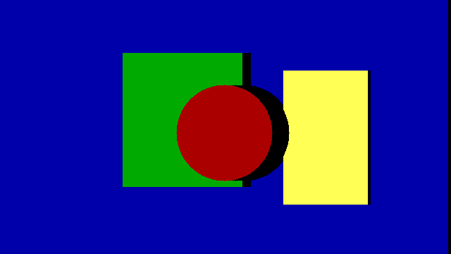
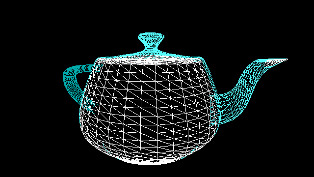

# Tang Mega 138K サンプル USER_LOGIC — RGB・Z バッファーから HDMI VRAM を生成する

このディレクトリは、Tang Mega 138K の DDR3 ポート s3 を使う **サンプル USER_LOGIC** である。入力は、同じカメラで位置合わせした 640×360 の RGB565 画像と Z16 深度画像。画素の奥行きから固定視点での表示位置を求め、手前の面を選び、1920×1080・固定16色の VRAM に書き出す。HDMI は独立した s4 ポートから完成した面を走査する。

| PSC-OS コマンド | 表示するもの | 入力データ |
|---|---|---|
| `teapot` | Utah ティーポットのワイヤーフレーム | ファームウェアに組み込んだ [teapot.obj](utah-teapot/teapot.obj) |
| `rgbz` | SD カードのカラー画像と深度画像から生成した固定視点画像 | SD ルートの [COLOR.RAW](samples/COLOR.RAW) と [DEPTH.RAW](samples/DEPTH.RAW) |

| ファイル | 役割 |
|---|---|
| [USER_LOGIC.v](USER_LOGIC.v) | ボードと子モジュールの信号を接続する親モジュール |
| [rgbz_to_vram.v](rgbz_to_vram.v) | 固定視点への投影、深度比較、色変換、3倍拡大、フレーム生成 |
| [rgbz_axi_master.v](rgbz_axi_master.v) | 256ビット AXI で RGB・Z を読み、非表示 VRAM に書く |
| [rgbz_tb.sv](tests/rgbz_tb.sv) | 参照画像と DDR3・HDMI の全画素を照合する結合テスト |

## 入力と出力

次の番地はボードの既定の変換構成における DDR3 **物理バイトアドレス**。この機能は `0x0080_0000` より上を使う。入力原点は左上、右を +x、下を +y とする。

| バッファー | 先頭 | 形式 | 1行 | 1面 |
|---|---|---|---:|---:|
| RGB | `0x00B0_0000` | RGB565、R[15:11]・G[10:5]・B[4:0] | 1,280 B | 460,800 B |
| Z | `0x00B8_0000` | 符号なし16ビット、光軸方向の距離（mm） | 1,280 B | 460,800 B |
| VRAM A（リセット時の表示面） | `0x0090_0000` | 1920×1080、4 bpp | 960 B | 1,036,800 B |
| VRAM B | `0x00A0_0000` | 同上 | 960 B | 1,036,800 B |

入力 (x,y) の番地は各入力面の `base + 2*(640*y + x)`。16ビット値は下位バイトから格納する。Z の有効値は 1～65534 mm で、0 と 65535 は欠測を表す。

## 固定視点への投影式

表示カメラを入力カメラから右へ **B = 50 mm** 移し、向き、主点、焦点距離 **f = 320 入力画素**をそろえる。空間点の入力カメラ座標を (X,Y,Z)、主点を (cx,cy) とすると、入力・表示カメラの横座標はそれぞれ次式になる。

```text
x = cx + f*X/Z
u = cx + f*(X - B)/Z = x - f*B/Z
v = y
```

RTL は正の視差を最も近い整数に丸め、ちょうど半画素なら大きい方を選ぶ。

```text
disparity = floor((16000 + floor(Z/2)) / Z)
u = x - disparity
```

例えば同じ入力行で、(x=108, Z=2000 mm) は8画素左、(x=116, Z=1000 mm) は16画素左に移り、ともに u=100 に着く。この位置には後者の色が残る。

## 1フレームを生成するアルゴリズム

1. **行を初期化する。** 640要素の行メモリに「深度65535、色番号0（黒）」を書き込む。カメラの水平移動で v=y が成り立つため、隠面判定には1行分のメモリで足りる。
2. **RGB と Z を対にして読む。** s3 から各32バイト（16画素）ずつ取得し、左から処理する。欠測 Z は除算前に除く。視差が x を超える点は左端の外へ出るので捨てる。
3. **表示色を決める。** RGB565 の各成分をビット反復で8ビット化する。5ビット値は `(a<<3)|(a>>2)`、6ビット値は `(a<<2)|(a>>4)`。固定パレットの各色 i に対し `D(i)=(R-Ri)²+(G-Gi)²+(B-Bi)²` を評価し、D(i) が最小となる色番号を選ぶ。同距離なら小さい番号を採用する。RTL は16クロックで除算を1ビットずつ進めながら、同時に1色ずつ調べる。[HDMI のパレット定義](../hdmi/dvi_vram_scanout.v)
4. **投影先で深度を比較する。** `Z < 行Z[u]` のときだけ、行メモリの深度と色番号を一緒に更新する。同じ深度なら先着を保持する。投影される点がない位置は黒のまま出力する。
5. **3倍に拡大してパックする。** (u,y) の色を、出力の X=3u～3u+2、Y=3y～3y+2 に複製する。出力バイト番地は `back_base + 960*Y + floor(X/2)`。偶数 X は下位ニブル、奇数 X は上位ニブルに入れる。左から色番号1、12なら格納バイトは `0xC1`。64画素を256ビットの1転送にまとめる。
6. **完成した面を表示する。** 最後の書き込み応答が成功してから面切替を要求する。HDMI はフレーム境界で新しい面の先頭行を先読みし、切替応答を返す。AXI エラー時は旧表示面を保持する。

## PSC-OS でサンプル画像を表示する

Tang 138K のトップを `COLOR_BAR_MODE=0`、`VRAM_ADDRESS=0x0090_0000` で使用する。対応する SD 起動ファームウェアは `make -C PSC-ONE/hardware/firmware firmware_fat32_tang138k` で生成できる。生成した `mem/tang138k/kernel.mem` と `user.mem` を、それぞれ SD カードのルートに `KERNEL.MEM`、`USER.MEM` として置く。同じ場所に次のサンプル2枚をコピーする。

- [COLOR.RAW](samples/COLOR.RAW) は手前の赤い円、緑と黄色の矩形、青い市松模様を描いた RGB565 画像。
- [DEPTH.RAW](samples/DEPTH.RAW) は対応する深度画像。赤は500 mm、緑は1000 mm、黄は2000 mm、背景は4000 mm。変換後はそれぞれ32、16、8、4入力画素だけ左に移動する。

UART シェルで `rgbz` を実行するとこの2ファイルを読み、変換完了後に表示面 A/B を出力する。別の画像には `rgbz MYRGB.RAW MYZ.RAW` を使う。両方ともルートの大文字 8.3 名、各460,800バイト、ヘッダ・行末パディングなし。自作画像でも各画素の RGB と Z は同じ位置にそろえる。[サンプル生成スクリプト](../../../../software/os/tools/make_rgbz_sample.py)

リポジトリのルートから次のコマンドで、配布した2ファイルを指定ディレクトリに再生成できる。

```sh
python3 PSC-ONE/software/os/tools/make_rgbz_sample.py /tmp/psc-rgbz-sample
```

下図はサンプルの投影結果を縦横1/3に縮めた参照画像。赤い円の右側に生じる黒い部分は、移動後の視点で初めて見える領域であり、入力から色を復元できない。



カーネルは入力の D キャッシュ書き戻し後、制御レジスタ `0x1000_A000` に1を書く。同番地の読み出し値 `0x5247425A` が対応ハードウェアの識別値。状態レジスタ `0x1000_A004` の bit 0～3 は順に BUSY、DONE、ERROR、表示面番号（A=0、B=1）。`vram_test` は表示中の面に16色の縦帯を書く。

## Utah ティーポットを表示する

同じ Tang 138K 用ファームウェアで、PSC-OS のプロンプトから引数なしで実行する。

```text
PSC_OS> teapot
```

左に取っ手、右に注ぎ口があるティーポットの三角形ワイヤーフレームが HDMI に現れる。OBJ はファームウェアに組み込むため、このコマンドに必要な SD ファイルは起動用の `KERNEL.MEM` と `USER.MEM` の2件。元の [teapot.obj](utah-teapot/teapot.obj) を更新した場合はファームウェアを再ビルドする。

- **ビルド時**に OBJ の3,644頂点・6,320三角形を読み込む。Y軸を上、+Z側を正面とし、水平12°・仰角13°の固定カメラ（焦点距離320画素）で640×360に透視投影する。スクリーン上の符号付き面積から表向き三角形を選び、共有辺と投影後の重複頂点をまとめる。付属モデルでは1,406頂点・3,818辺になる。[データ生成](../../../../software/os/tools/pack_teapot.py)
- **実行時**に CPU が RGB と Z をクリアし、辺を Bresenham 法でラスタライズする。端点間の深度を線形補間し、同じ入力画素には手前の線を残す。明るい白からシアンの色分けは深度に対応する。続いて USER_LOGIC が上記の再投影と3倍拡大を行い、フレーム境界で表示する。[線の描画](../../../../software/os/src/drivers/rgbz_teapot.c)



## RTL シミュレーション

リポジトリのルートから次のコマンドで検証できる。DDR3 に格納された VRAM と HDMI からの可視画素を独立した参照画像に照合し、A/B 両面、CPU・DMA 競合、エラー応答後の復帰を検証する。

```sh
make -C PSC-ONE/hardware/sim -f Makefile.tang138k.cpu simulate_RGBZ
```
